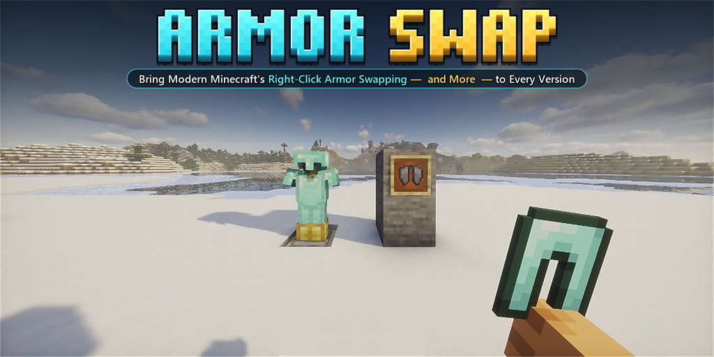

## About ArmorSwap

A lightweight plugin that adds the functionality to switch armor with your hand, armor stands, item frames, and more across Minecraft 1.8 - 1.21+ (including Folia).

## Features

- Ability to switch armor you are wearing with the one you hold in your hand.
- Ability to switch armor you are wearing with an armor stand (Shift right-click).
- Ability to switch items or armor you are wearing with an item frame (Shift right-click).
- A command to switch held items to your head (`/armorswap head`).
- A command to toggle plugin functionality per player (`/armorswap`).
- Works with WorldGuard, GriefPrevention, Kingdoms, and other protection plugins.
- Respects Curse of Binding with a configurable bypass permission.
- Disable each feature in the config.
- Fully customizable messages and sound.

## Showcase

### Right-Click Main-Hand Swap

### Armor Stand Swap (Shift + Right-Click)

### Item Frame Swap (Shift + Right-Click)

## Commands and Permissions

Aliases: `/armorswap`, `/armor`, `/as`

`/armorswap` - Enable or disable armor swapping for yourself
- Permission: `armorswap.command.use`

`/armorswap head` - Swap item in hand to head
- Permission: `armorswap.command.head`

`/armorswap reload` - Reload plugin config
- Permission: `armorswap.command.reload`

`/armorswap help` - Show command help

### Feature Permissions (configurable in `config.yml`)

- `armorswap.swap.mainhand` - Right-click main hand swap
- `armorswap.swap.armorstand` - Shift right-click armor stand swap
- `armorswap.swap.itemframe` - Shift right-click item frame swap
- `armorswap.bypass.enchantment` - Bypass Curse of Binding
